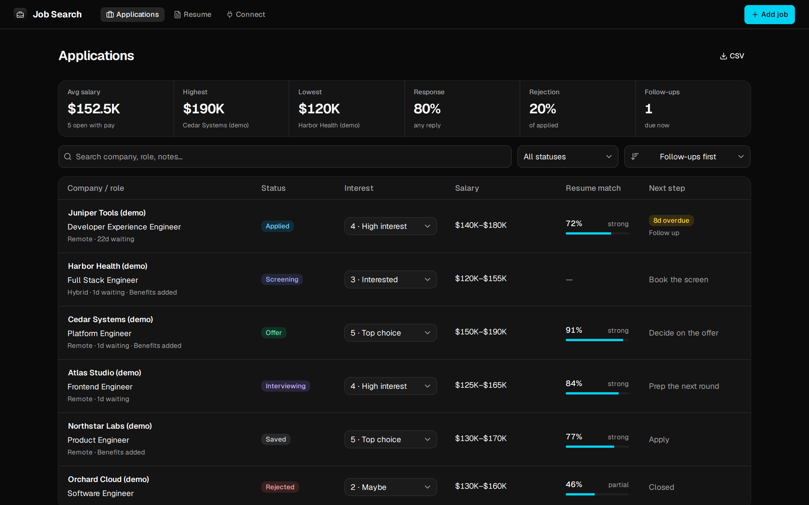
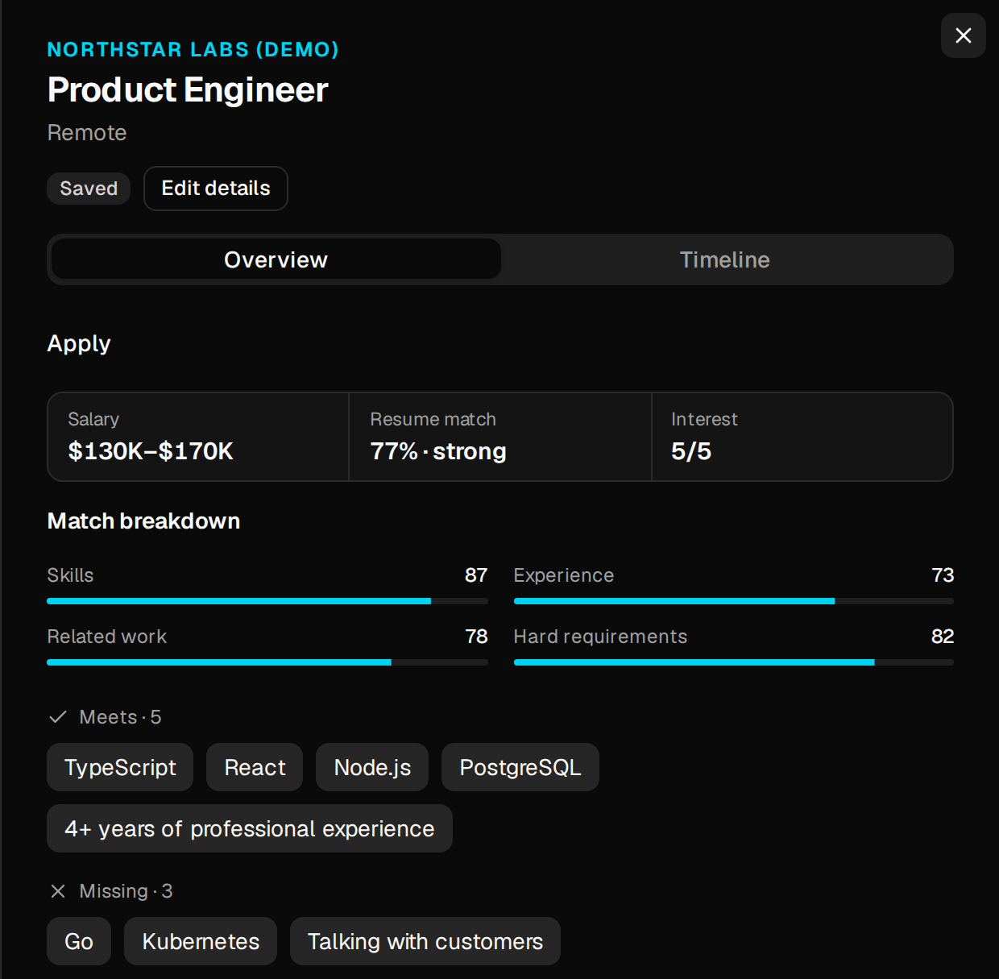
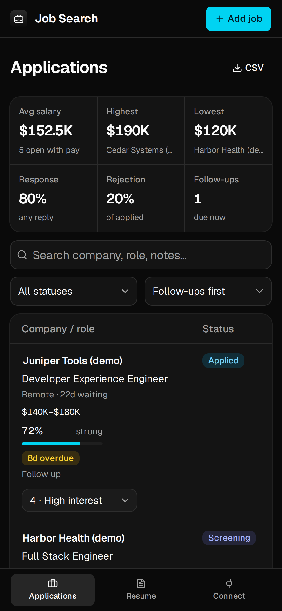
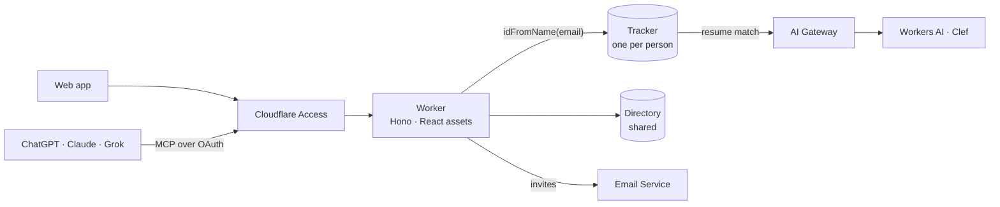

<p align="center">
  
</p>

<h1 align="center">Job Search</h1>

<p align="center">
  A private job-application tracker that your AI assistant can work in too.<br>
  One Cloudflare Worker, one SQLite database per person, sign-in by Cloudflare Access.
</p>

<p align="center">
  
</p>

I built this for my own job search, and a few friends and family now use it too. Each person signs in with Google and gets their own tracker. They can also connect ChatGPT, Claude or Grok, so the assistant reads their recruiter emails, logs replies, finds new postings and scores each one against their resume.

## Highlights

- **Every application in one place.** Status, salary range, benefits, contacts, what the employer asked for, and a timeline of every email, call and interview. Export everything to CSV.
- **Tells you what to do next.** Each row shows the next step: apply, book the screen, prep the next round, decide on the offer. A follow-up comes due 14 days after you apply or last nudge, and you can mark it done or skip it.
- **Resume match.** Cloudflare's Clef model scores how well your resume fits a posting, 0–100, broken down into skills, experience, related work and hard requirements, with the requirements you meet and miss.
- **Works with your AI assistant.** A built-in [MCP](https://modelcontextprotocol.io) server lets ChatGPT, Claude, Grok and Claude Code read and update your tracker, with the same sign-in and the same data isolation as the web app.
- **Private by design.** Each person's data lives in its own Durable Object, picked only by their verified email. Contact details are stripped from your resume before scoring, and AI requests aren't logged.
- **Live everywhere.** Changes from the web app, the API or an AI assistant show up in every open tab immediately, over a hibernating WebSocket.
- **Admin page.** Invite people by email, see who has signed in, raise someone's daily scoring limit, and watch AI spending against Cloudflare's free allowance.

<table>
  <tr>
    <td width="62%"></td>
    <td width="38%"></td>
  </tr>
</table>

## How it works



**Sign-in and isolation.** Cloudflare Access sits in front of the whole hostname. The Worker verifies the Access JWT itself (signature, audience and issuer), takes the email from it and opens `TRACKER.idFromName(email)`. Nothing in a request chooses whose data is read, so the REST API, the MCP endpoint and the live socket can only ever reach the signed-in person's tracker. Service tokens carry no email and are refused.

**Storage.** Each `Tracker` Durable Object holds one person's applications, timeline events and resume in SQLite. It applies its [Drizzle](https://orm.drizzle.team) migrations at startup inside `blockConcurrencyWhile`, and the Worker talks to it through typed RPC. A single `Directory` object stores the shared bits: who has signed in, display names and the AI spending limit.

**Resume match.** The browser extracts text from a PDF with [unpdf](https://github.com/unjs/unpdf), so the file never leaves the device. Before scoring, `redact()` in `src/match.ts` removes the name, email, phone, links and street address. Each score is one request to Cloudflare's Clef model on [Workers AI](https://developers.cloudflare.com/workers-ai/) through an AI Gateway with logging off and a daily spend limit. Each person gets 100 scores a day; an admin can allow more.

**MCP.** `/mcp` serves nine tools over Streamable HTTP: `list_applications`, `get_application`, `add_application`, `update_application`, `log_event`, `delete_application`, `get_resume`, `save_resume` and `score_jobs`. Tool definitions live once in `src/mcp/tools.ts`, and `mcp/server.ts` serves the same set over stdio for local clients. AI clients sign in through Access Managed OAuth, so they see exactly what the person sees.

**Live updates.** `GET /api/v1/live` opens a WebSocket on the person's tracker. After any change, the tracker sends `{"type":"changed"}` to their open tabs, which refetch. The socket uses the Hibernation API, and `ping`/`pong` is answered without waking the object.

**Guard rails.** Strict CSP and security headers on every response, per-person rate limits (120 requests a minute, 10,000 a day), no `workers.dev` or preview URLs, and production deploys only from CI on `main`.

## Tech stack

| Layer      | Choice                                                                                                 |
| ---------- | ------------------------------------------------------------------------------------------------------ |
| Runtime    | Cloudflare Workers, Durable Objects (SQLite), Workers AI, AI Gateway, Email Service                    |
| API        | [Hono](https://hono.dev), [Zod](https://zod.dev), [jose](https://github.com/panva/jose) for JWT checks |
| Data       | [Drizzle ORM](https://orm.drizzle.team) with generated SQL migrations                                  |
| Web        | React 19, Tailwind CSS 4, [shadcn/ui](https://ui.shadcn.com)                                           |
| Toolchain  | [Vite+](https://viteplus.dev): Vite 8 with Rolldown, Vitest 5, Oxfmt and Oxlint                        |
| AI clients | [MCP TypeScript SDK](https://github.com/modelcontextprotocol/typescript-sdk)                           |
| Tests      | Vitest inside the Workers runtime via `@cloudflare/vitest-plugin`                                      |

## Project layout

```text
src/
  worker.ts            entry: Access check, rate limit, routes, MCP, daily cron
  tracker.ts           per-person Durable Object
  match.ts             resume redaction and Clef scoring
  applications/        REST routes, field rules, validation, CSV
  people/              admin: Access group, invites, AI spending, directory
  mcp/tools.ts         MCP tool definitions
  web/                 React app (views, components, client API)
mcp/server.ts          same MCP tools over stdio
drizzle/               SQL migrations
test/                  Vitest suites, run in workerd
```

## Run it locally

Requires Node 22.18+ or 24.11+ and pnpm 10.

```sh
pnpm install
pnpm dev
```

Wrangler mocks Cloudflare Access locally, so you're signed in as `developer@localhost`. Resume scoring calls the real Workers AI, so it needs `wrangler login`.

## Checks

```sh
pnpm format:check && pnpm lint && pnpm check && pnpm test && pnpm deploy:check
```

CI runs the same steps on every pull request, and also fails if `src/db/schema.ts` changed without a generated migration.

## Deploy your own

You need a Cloudflare account with a domain on it. The free plan is enough to try it; Workers Paid lets scoring go past the daily free AI allowance.

1. **Access.** In Zero Trust, add Google (or One-time PIN) as a login method. Create a self-hosted application for your hostname, with one Allow policy that includes an Access group of people's emails.
2. **Managed OAuth** on that application, for AI clients. Turn on dynamic client registration and allow the redirect URIs `https://chatgpt.com/*`, `https://claude.ai/*`, `https://claude.com/api/mcp/auth_callback`, `https://grok.com/connectors-oauth-exchange-code/` and `http://localhost:*`.
3. **AI Gateway.** Create a gateway named `job-search` with logging off and a daily spend limit.
4. **Email Service.** Onboard your domain for sending, so invites can go out from it.
5. **Configure** `wrangler.jsonc`: your route, `ACCESS_AUD` and `ACCESS_TEAM_DOMAIN` from the Access app, `ACCESS_GROUP_ID`, `CLOUDFLARE_ACCOUNT_ID`, `ADMIN_EMAILS` and `INVITE_FROM`.
6. **Secrets.** Create an API token with Access: Groups Edit, AI Gateway Edit and Account Analytics Read, then store it as both secrets:
   ```sh
   pnpm exec wrangler secret put ACCESS_GROUPS_TOKEN
   pnpm exec wrangler secret put AI_GATEWAY_TOKEN
   ```
7. **Deploy** with `pnpm run deploy`, or add `CLOUDFLARE_ACCOUNT_ID` and `CLOUDFLARE_API_TOKEN` to a GitHub environment named `production` so every green push to `main` deploys.

Steps 4 and 6 are optional. Without them the tracker works, but the Admin page can't send invites, add people or show spending.

## Connect an AI assistant

The app's **Connect** page has a copyable URL and steps for each client. For example, in Claude Code:

```sh
claude mcp add --transport http job-search https://<your-host>/mcp
```

Then run `/mcp` and sign in. The Connect page also has ready-made prompts: a daily email sync that logs replies from recruiters, and a job finder that searches for postings and scores them against your resume.

## Cost

Durable Objects and the Worker cost little at this size. Resume scoring is the only real spend: about $0.0002 per score on Workers AI. Cloudflare's free allowance (10,000 neurons, about $0.11 a day) covers a few hundred scores, and the AI Gateway spend limit caps the rest. The admin page can raise that limit for the rest of the day, and a cron job at 00:01 UTC puts it back.
